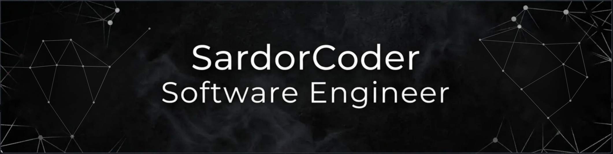

  

  Hi there! My name is <b>Sardor</b>, but you might know me as <b>SardorCoder</b>.
  I'm a <b>Software Engineer</b> from <b>Uzbekistan</b>.
  I enjoy working with <b>TypeScript</b>, <b>Next.js</b>, <b>React Native</b>, and <b>Node.js</b>.
  I'm passionate about <b>Open Source</b> and <b>Community Growth</b>.

  <a href="https://SIZNING-PORTFOLIO.uz">portfolio</a> ·
  <a href="https://github.com/allamurotov?tab=repositories">projects</a> ·
  <a href="https://SIZNING-BLOG.uz">blog</a> ·

  
  
  

